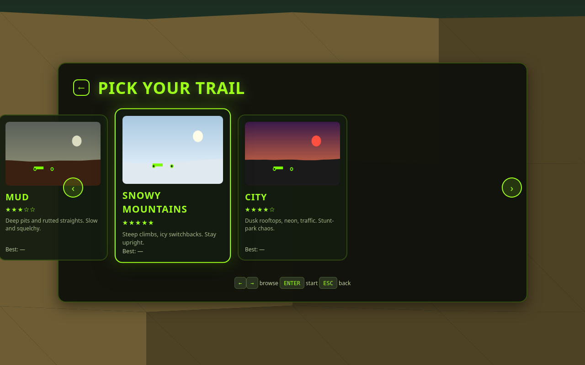
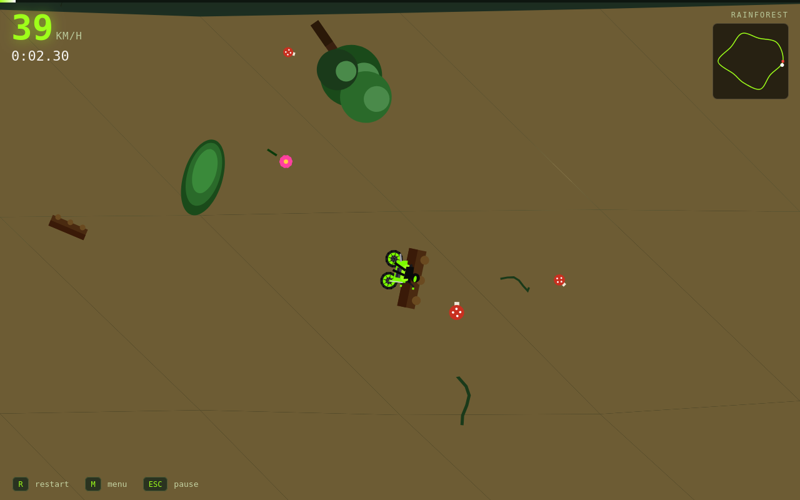
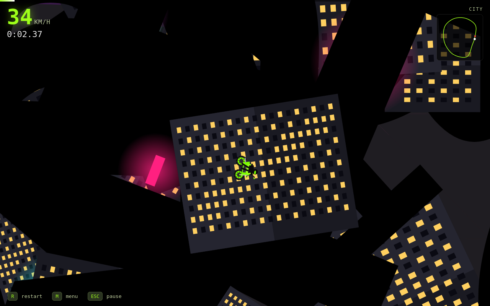

# Lime Rider — One-Shot Dirtbike

A single-file browser dirtbike game. Five distinct biomes (rainforest, desert, mud, snow, city), a lime-green bike, and a map-select screen with procedurally-drawn biome previews.



**Open `index.html` in any modern browser. No build step. No dependencies.**

## Play

- **W / ↑** — throttle
- **S / ↓** — brake
- **A / ←** — lean back
- **D / →** — lean forward
- **SPACE** — handbrake
- **R** — restart current map
- **M** — back to map select
- **ESC** — pause / back

On touch devices, on-screen buttons appear automatically.

## Maps

| Map | Vibe | Difficulty |
|---|---|---|
| **Rainforest** | Roots, mud, mist. Steep climbs over fallen logs. | ★★★ |
| **Desert** | Dunes, cacti, scorching sun. Long jumps. | ★★★★ |
| **Mud** | Deep pits and rutted straights. Slow and squelchy. | ★★★ |
| **Snowy Mountains** | Steep climbs, icy switchbacks. Stay upright. | ★★★★★ |
| **City** | Dusk rooftops, neon, traffic. Stunt-park chaos. | ★★★★ |




## Tech

- **One file:** `index.html` (~80 KB). All CSS and JS inline.
- **Canvas 2D** rendering.
- **No external assets.** Every prop, texture, and SFX is generated at runtime. Procedural terrain per biome (different noise frequencies, amplitudes, and roughness), Catmull-Rom closed-loop track, Mulberry32 RNG seeded per biome.
- **Web Audio API** for synth SFX (engine pitch, brake skid, mud splat, jump whoosh, finish fanfare) and per-biome ambient beds.
- **LocalStorage** for best times per map.
- **120 Hz fixed-timestep physics** sub-stepped inside the rAF tick, variable render.
- **Top-down arcade camera** centered on the bike.

## Tested

`tests/full-test.js` is a Playwright headless test suite that exercises:
- Title screen visible on first frame
- Map select shows 5 cards with distinct biome thumbnails
- Carousel nav (Arrow keys)
- All 5 biomes start races, bike position finite
- Acceleration on W, braking on S, steering on A/D
- ESC pauses/resumes

30/30 pass. Run it yourself:
```bash
cd tests && npm install playwright && npx playwright install firefox
node full-test.js
```

## Credits

Built by Blake via Hermes Agent, June 2026. All procedural — no external art, audio, or libraries used.
